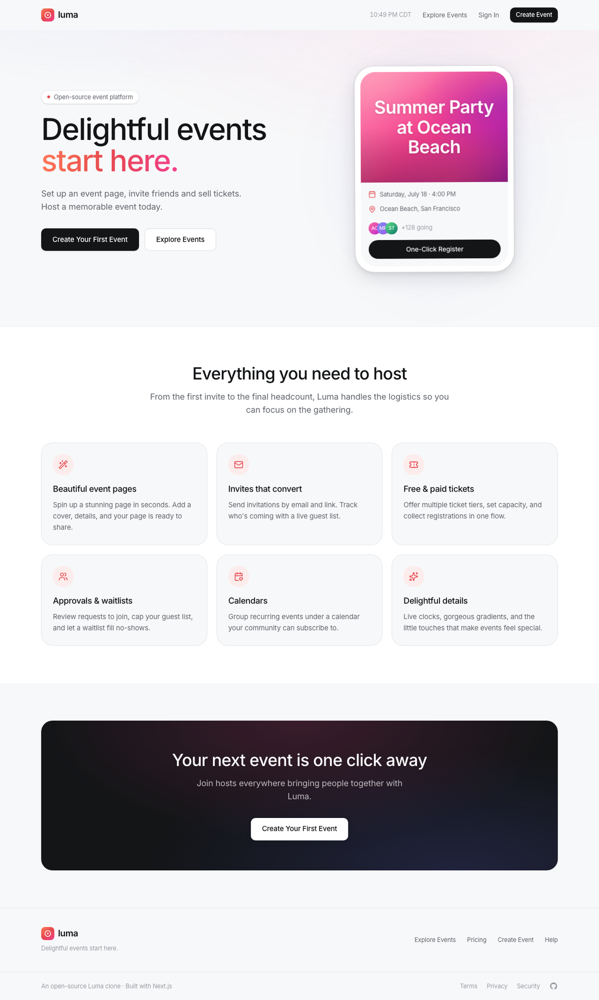
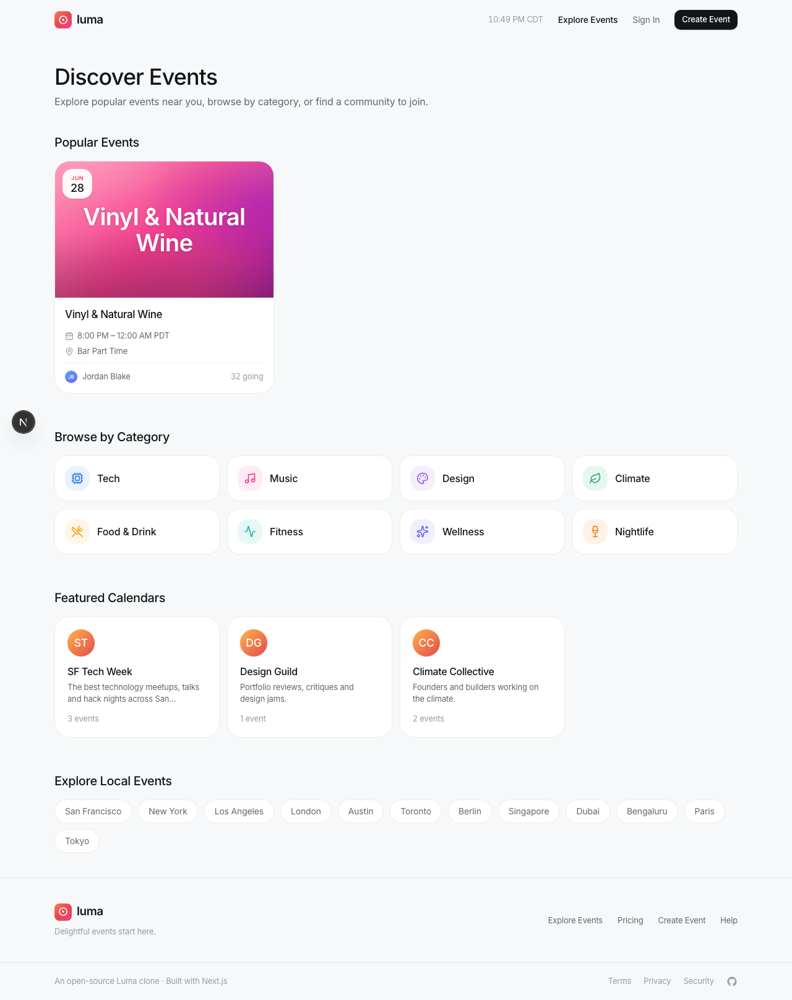
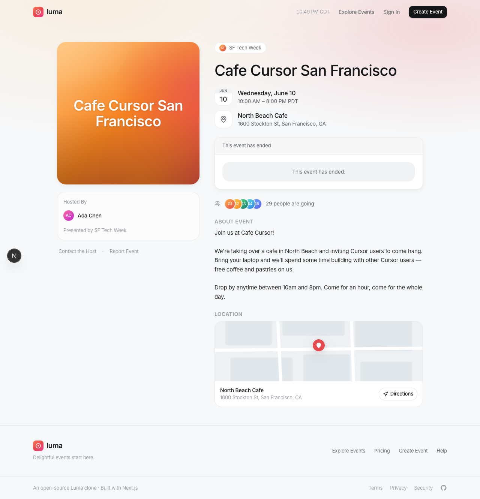

<div align="center">

# Luma

**An open-source, self-hostable clone of [lu.ma](https://lu.ma) — delightful events start here.**

Beautiful event pages, one-click RSVPs, ticketing, calendars, and discovery.
Built to look and feel like the real thing.



</div>

---

## ✨ Features

- **Marketing home** — faithful hero, animated mockup, the works
- **Event pages** — two-column layout with cover, hosts, date/time, ticket selection, registration, attendee list, and map
- **One-click registration** — going / waitlist / approval flows, capacity limits, guest cookies
- **Create events** — live cover preview with generated gradient covers (8 colors × 5 patterns), location types, free & paid tickets, approval toggle
- **Discover** — browse events by category, featured calendars, and cities
- **My Events dashboard** — events you host and attend, upcoming/past tabs
- **Passwordless auth** — magic-link style sign in, session cookies
- **Self-contained** — gorgeous generated covers mean zero external image dependencies

## 🖼️ Screenshots

| Discover | Event page |
|---|---|
|  |  |

| Create an event |
|---|
|  |

## 🧱 Tech stack

- **[Next.js 16](https://nextjs.org)** (App Router, Turbopack) + **React 19** + **TypeScript**
- **[Tailwind CSS v4](https://tailwindcss.com)** with a Luma-faithful token system
- **[Drizzle ORM](https://orm.drizzle.team)** + **[libSQL](https://github.com/tursodatabase/libsql)** (local SQLite file, zero native build)
- **Inter** via `next/font`, **lucide-react** icons, **zod** validation

No native compilation, no external services required to run locally.

## 🚀 Quick start

```bash
pnpm install
cp .env.example .env      # defaults work out of the box
pnpm setup                # create the SQLite db + seed demo data
pnpm dev                  # http://localhost:3000
```

That's it. The seed creates demo users, calendars, and ~10 events so the app
looks alive immediately.

### Scripts

| Command | Description |
|---|---|
| `pnpm dev` | Start the dev server |
| `pnpm build` / `pnpm start` | Production build / serve |
| `pnpm setup` | Migrate + seed the database |
| `pnpm db:generate` | Generate a migration from the schema |
| `pnpm db:migrate` | Apply migrations |
| `pnpm db:seed` | Re-seed demo data |
| `pnpm db:studio` | Open Drizzle Studio |

## 🔌 Connect your real Luma calendar (experimental)

This project is being wired to the official **[Luma API](https://docs.lu.ma)** so it
can mirror a real Luma calendar. Set a Luma Plus API key to opt in:

```bash
# .env
LUMA_API_KEY=secret-xxxxxxxxxxxxxxxxxxxx
```

When unset, the app runs entirely on local seed data. _(Live sync is in active
development — see the roadmap below.)_

## 🗺️ Roadmap

- [ ] Live Luma API integration — render a connected calendar's real events
- [ ] Manage event page — guest list, approve/decline, check-in
- [ ] Calendar pages with subscribe
- [ ] RSVP write-back to Luma

## 📁 Project structure

```
app/            # routes (home, /discover, /create, /signin, /home, /[slug])
  actions/      # server actions (registration, events, auth)
components/     # UI primitives + composed components
db/             # Drizzle schema, migrations, seed
lib/            # data access, auth/session, date + utility helpers
```

## 📄 License

[MIT](LICENSE) — a learning project and homage to Luma's lovely product design.
Not affiliated with Luma.
