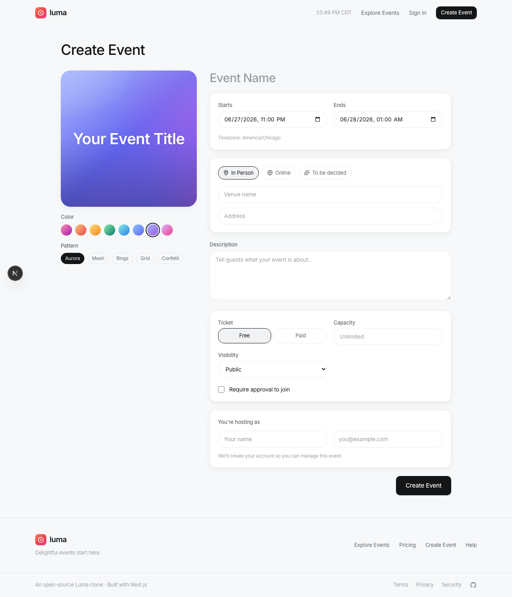
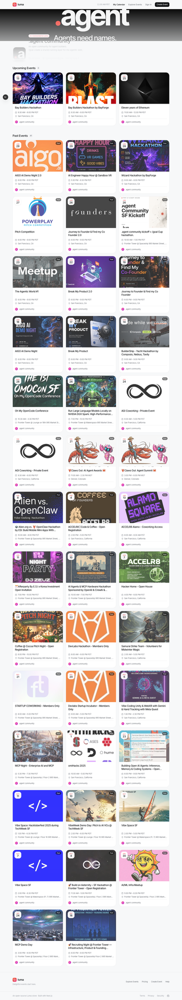
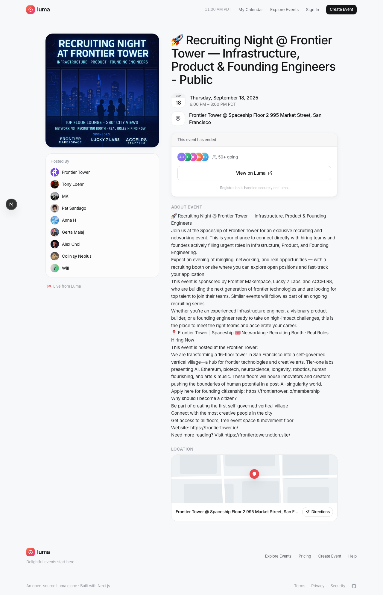

<div align="center">

# Luma

**An open-source, self-hostable clone of [lu.ma](https://lu.ma) — delightful events start here.**

Beautiful event pages, one-click RSVPs, ticketing, calendars, and discovery.
Built to look and feel like the real thing.


</div>

---

## ✨ Features

- **Marketing home** — faithful hero, animated mockup, the works
- **Event pages** — two-column layout with cover, hosts, date/time, ticket selection, registration, attendee list, and map
- **One-click registration** — going / waitlist / approval flows, capacity limits, guest cookies
- **Create events** — live cover preview with generated gradient covers (8 colors × 5 patterns), location types, free & paid tickets, approval toggle
- **Discover** — browse events by category, featured calendars, and cities
- **My Events dashboard** — events you host and attend, upcoming/past tabs
- **Host tools** — a manage page per event: live stats, searchable guest list, approve/decline requests, and a copy-able invite link
- **Rich descriptions** — GitHub-flavored markdown rendering for event details
- **Passwordless auth** — magic-link style sign in, session cookies
- **🔴 Live Luma API integration** — connect a real Luma Plus calendar and the app mirrors your actual events, hosts, guests, and covers as a first-party experience
- **Self-contained** — gorgeous generated covers mean zero external image dependencies (local mode needs no network at all)

## 🖼️ Screenshots

| Discover | Event page |
|---|---|
|  |  |

| Create an event |
|---|
|  |

## 🧱 Tech stack

- **[Next.js 16](https://nextjs.org)** (App Router, Turbopack) + **React 19** + **TypeScript**
- **[Tailwind CSS v4](https://tailwindcss.com)** with a Luma-faithful token system
- **[Drizzle ORM](https://orm.drizzle.team)** + **[libSQL](https://github.com/tursodatabase/libsql)** (local SQLite file, zero native build)
- **Inter** via `next/font`, **lucide-react** icons, **zod** validation

No native compilation, no external services required to run locally.

## 🚀 Quick start

```bash
pnpm install
cp .env.example .env      # defaults work out of the box
pnpm setup                # create the SQLite db + seed demo data
pnpm dev                  # http://localhost:3000
```

That's it. The seed creates demo users, calendars, and ~10 events so the app
looks alive immediately.

### Scripts

| Command | Description |
|---|---|
| `pnpm dev` | Start the dev server |
| `pnpm build` / `pnpm start` | Production build / serve |
| `pnpm setup` | Migrate + seed the database |
| `pnpm db:generate` | Generate a migration from the schema |
| `pnpm db:migrate` | Apply migrations |
| `pnpm db:seed` | Re-seed demo data |
| `pnpm db:studio` | Open Drizzle Studio |

## 🔌 Connect your real Luma calendar

Set a **[Luma Plus](https://lu.ma/pricing) API key** ([lu.ma/settings/api](https://lu.ma/settings/api))
and the app connects to the official **[Luma API](https://docs.lu.ma)**:

```bash
# .env
LUMA_API_KEY=secret-xxxxxxxxxxxxxxxxxxxx
```

Then a **My Calendar** tab appears in the nav and the app renders your real Luma
calendar — live events, hosts, guest lists, and cover art — as if it were
first-party:

| Your connected calendar (`/calendar`) | A live event (`/event/[id]`) |
|---|---|
|  |  |

Registration for live events links out to Luma so nothing is written to your real
calendar without your intent. When `LUMA_API_KEY` is unset, the app runs entirely
on local seed data.

How it works: `lib/luma/` wraps the API (`calendar/get`, `calendar/list-events`,
`event/get`, `event/get-guests`) with ISR caching, and a small adapter maps Luma
events onto the same view-model the local `EventCard` uses — so one set of
components renders both sources.

## 🗺️ Roadmap

- [x] Manage event page — searchable guest list, approve/decline, invite link
- [x] Markdown rendering for event descriptions
- [ ] Calendar pages with subscribe (local calendars)
- [ ] Opt-in RSVP write-back to Luma (`event/add-guests`)
- [ ] Check-in / QR at the door

## 📁 Project structure

```
app/            # routes: home, /discover, /create, /signin, /home,
  [slug]/       #   local event pages
  calendar/     #   connected Luma calendar (live)
  event/[id]/   #   live Luma event pages
  actions/      #   server actions (registration, events, auth)
components/     # UI primitives + composed components
db/             # Drizzle schema, migrations, seed
lib/            # data access, auth/session, dates, utils
  luma/         #   Luma API client, types, queries + mappers
  view.ts       #   shared card view-model (local + Luma feed one card)
```

## 📄 License

[MIT](LICENSE) — a learning project and homage to Luma's lovely product design.
Not affiliated with Luma.
